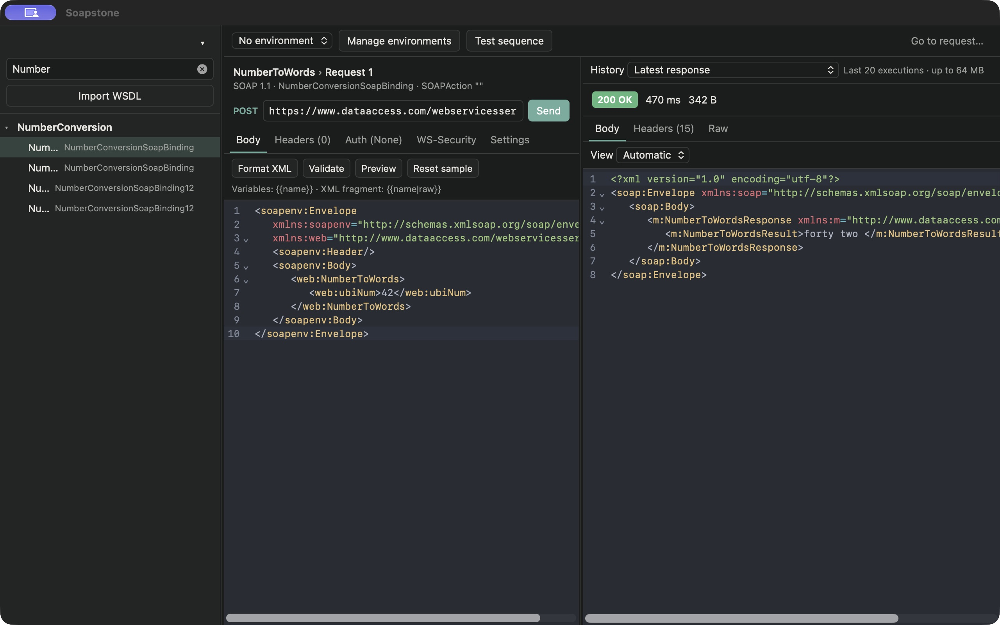
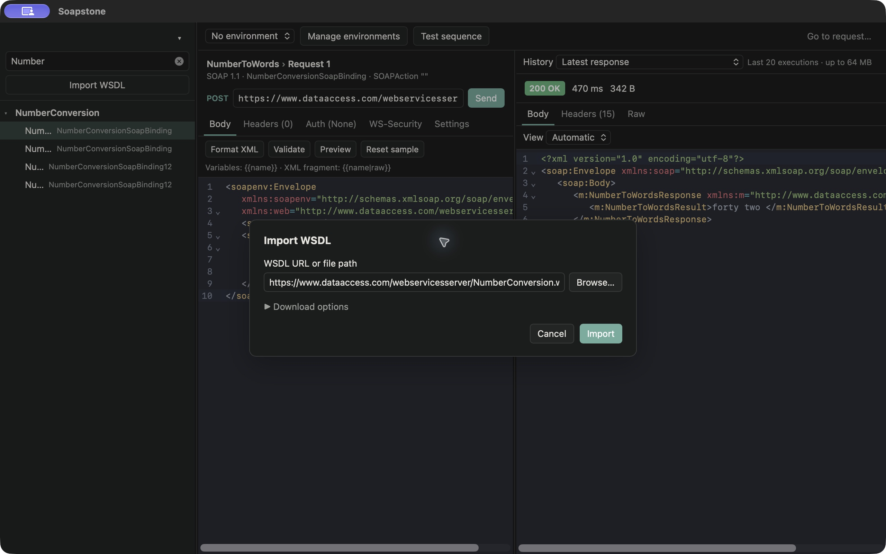
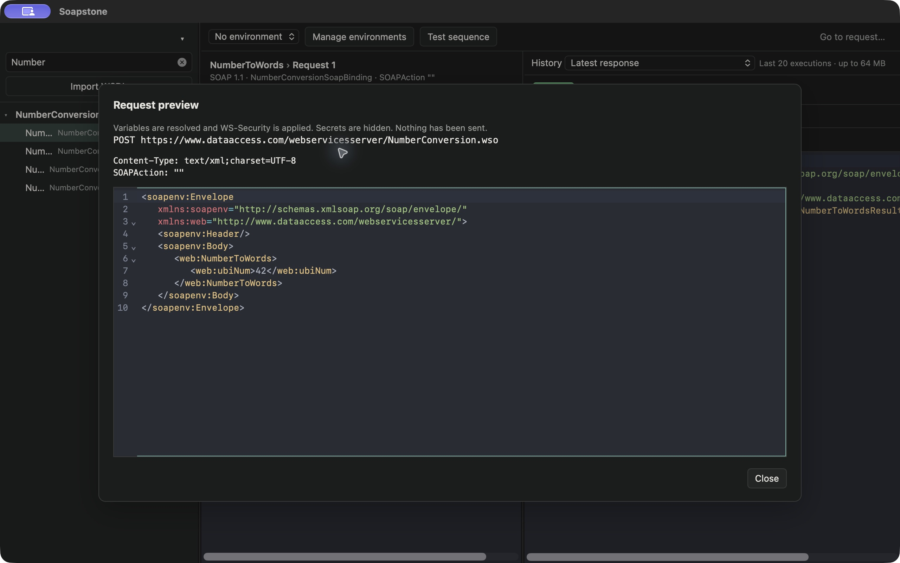
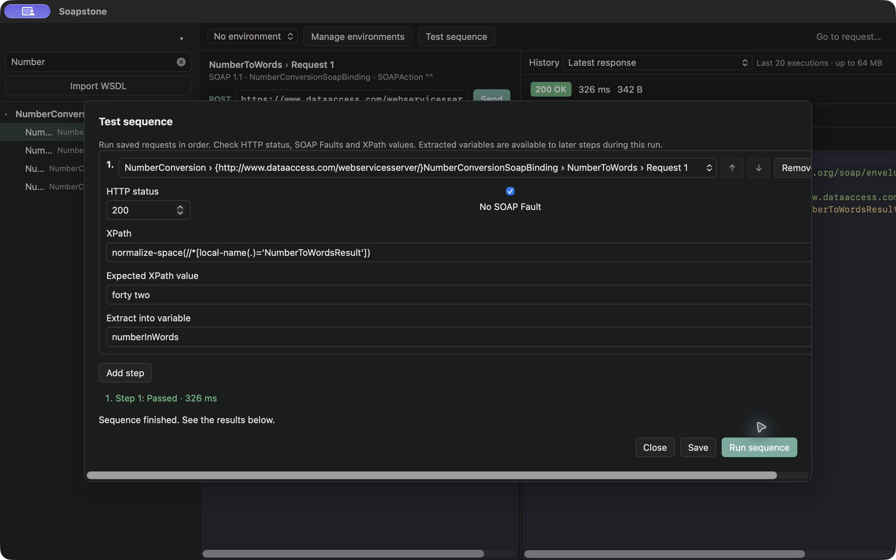

<p align="center">
  
</p>

<h1 align="center">Soapstone</h1>

<p align="center">
  A focused desktop client for SOAP APIs.<br>
  Import a WSDL, edit the generated XML and inspect the response.
</p>

<p align="center">
  <a href="https://github.com/gsimei/SoapUI-RE/actions/workflows/ci.yml"></a>
  <a href="LICENSE"></a>
  
</p>

<p align="center">
  <a href="#install">Install</a> ·
  <a href="#your-first-request">Quick start</a> ·
  <a href="docs/usage.md">User guide</a> ·
  <a href="#development">Development</a> ·
  <a href="https://github.com/gsimei/SoapUI-RE/issues">Report an issue</a>
</p>

Soapstone is a free, open-source alternative to SoapUI for everyday SOAP work, built with **Rust, Tauri and React**.
Organize services into projects, switch environments, reuse requests and run test sequences from one desktop app.
Projects and response history stay on your machine in SQLite; no Soapstone account is required.

> **Early development:** the current version is 0.1.0. The features below are implemented, but the application is still
> evolving. See [Releases](https://github.com/gsimei/SoapUI-RE/releases) for published installers, or
> [run from source](#run-from-source).



*A real request to the public NumberConversion service: `42` in, `forty two` out.*

## Features

| | What you can do |
| --- | --- |
| **WSDL to request** | Import a URL or local file, follow imported WSDLs and schemas, and generate sample XML for each operation. Supports SOAP 1.1 and 1.2, document and RPC bindings. |
| **XML workspace** | Edit with syntax highlighting, variable completion and value/origin tooltips. Format, validate, preview or restore the generated sample. |
| **Environments** | Use base variables and named environments in endpoints, headers, XML and authentication. Keep secret variables in the system keychain. |
| **Authentication** | Basic, Bearer and NTLM; PKCS#12 client certificates; WS-Security UsernameToken and Timestamp. Set custom headers and request timeouts. |
| **Response inspection** | Inspect HTTP status, duration, size, headers, formatted XML and raw text. Browse response history, compare changes and identify SOAP Faults. |
| **Repeatable workflows** | Duplicate requests, run ordered test sequences, check status and XPath values, and pass extracted values to later steps. |
| **Migration and sharing** | Import SoapUI XML projects. Export and import portable `.soapstone.json` projects with cached WSDLs, requests, environments and test sequences. |

Search operations, jump to a request with **⌘P / Ctrl+P**, resize the panes and use the light or dark appearance provided
by your system. Refreshing a WSDL preserves saved requests and marks operations removed from the service definition.
Binding namespaces are preserved even when imported WSDLs reuse the same local names.

## Install

### Packaged application

Check [GitHub Releases](https://github.com/gsimei/SoapUI-RE/releases) for an installer for your system. If no release
has been published yet, use the source instructions below. Rust and Node.js are only needed to build from source.

| System | Package | Installation |
| --- | --- | --- |
| **macOS — Apple Silicon** | `.dmg` containing `aarch64` | Open the disk image and drag Soapstone to **Applications**. |
| **macOS — Intel** | `.dmg` containing `x64` | Open the disk image and drag Soapstone to **Applications**. |
| **Windows** | `.msi` or `-setup.exe` | Run the installer and follow the setup steps. |
| **Linux — Debian / Ubuntu** | `.deb` | Run `sudo apt install ./Soapstone_*.deb` from the download folder. |
| **Linux — AppImage** | `.AppImage` | Run `chmod +x Soapstone_*.AppImage`, then open the file. |

<details>
<summary>Opening unsigned builds on macOS and Windows</summary>

The release workflow currently produces unsigned builds. Only open installers you obtained from this repository's
releases or built yourself.

- **macOS:** try opening Soapstone once, then go to **System Settings → Privacy & Security → Open Anyway** if macOS
  blocks it. If a trusted build is reported as damaged after downloading, remove its quarantine attribute:

  ```bash
  xattr -dr com.apple.quarantine /Applications/Soapstone.app
  ```

- **Windows:** if SmartScreen blocks a trusted installer, choose **More info → Run anyway**.

</details>

### Run from source

Install **Git**, **Rust 1.88 or newer**, **Node.js 22.12 or newer**, and the
[Tauri system prerequisites](https://v2.tauri.app/start/prerequisites/) for your platform:

- **macOS:** Xcode Command Line Tools (`xcode-select --install`).
- **Windows:** Microsoft C++ Build Tools with **Desktop development with C++**, and the WebView2 runtime.
- **Linux:** WebKitGTK 4.1 and the build packages listed in the Tauri guide for your distribution.

Then run:

```bash
git clone https://github.com/gsimei/SoapUI-RE.git
cd SoapUI-RE
npm --prefix app ci
npm --prefix app run tauri dev
```

This starts the frontend and opens the desktop application. The first build compiles the Rust dependencies and can
take a few minutes. To create an optimized application and installers for the current system:

```bash
npm --prefix app run tauri build
```

Find the packaged output under `target/release/bundle/`.

## Your first request

### 1. Import a WSDL

Open Soapstone and click **Import WSDL** in the sidebar. Paste your service's WSDL URL or click **Browse…** to choose
a local `.wsdl` or `.xml` file, then click **Import**. The default project is created automatically.

Soapstone discovers the service's operations and creates a sample request for each one. Use the project name at the
top of the sidebar to create or switch projects. WSDL download credentials are available under **Download options**.

To follow the same example as the screenshots, import the public
[DataAccess NumberConversion WSDL](https://www.dataaccess.com/webservicesserver/NumberConversion.wso?WSDL):

```text
https://www.dataaccess.com/webservicesserver/NumberConversion.wso?WSDL
```

It provides **NumberToWords** and **NumberToDollars**, with SOAP 1.1 and 1.2 bindings and no authentication required.
The example service is hosted by DataAccess; its availability is independent of Soapstone.

<details>
<summary>See the WSDL import dialog</summary>



</details>

### 2. Edit and send

Select **NumberToWords** with the **NumberConversionSoapBinding** binding (SOAP 1.1) in the sidebar, then replace
the request body with:

```xml
<soapenv:Envelope
   xmlns:soapenv="http://schemas.xmlsoap.org/soap/envelope/"
   xmlns:web="http://www.dataaccess.com/webservicesserver/">
   <soapenv:Header/>
   <soapenv:Body>
      <web:NumberToWords>
         <web:ubiNum>42</web:ubiNum>
      </web:NumberToWords>
   </soapenv:Body>
</soapenv:Envelope>
```

The endpoint is `https://www.dataaccess.com/webservicesserver/NumberConversion.wso`. Click **Validate** to check
the XML and variables, or **Preview** to inspect the resolved request. Click **Send** or press **⌘Enter / Ctrl+Enter**.
Request edits are saved automatically. **Cancel** stops a request in progress.

<details>
<summary>See the request preview</summary>



</details>

### 3. Inspect the response

The right pane shows the HTTP status, elapsed time and response size. The example returns **200 OK** and a
`NumberToWordsResult` containing `forty two`. Use **Body** for formatted XML, **Headers** for response headers and **Raw** for
the original response text. SOAP Faults are flagged separately from the HTTP status.

Send again after changing an input, then use **History** to open an earlier response and **Compare with latest** to
inspect the changed lines. Each request retains up to 20 responses, within a 64 MB history budget; a single response
is limited to 32 MB. Failed or cancelled exchanges preserve the previous response.

## Use environments and variables

Open **Manage environments**. Add shared values to **Base variables**, or create an environment such as `Local` or
`Staging`. An active environment overrides base variables with the same names.

For the example, define `number` as `42`, then replace the operation inside the SOAP Body with:

```xml
<web:NumberToWords>
   <web:ubiNum>{{number}}</web:ubiNum>
</web:NumberToWords>
```

Select your named environment in the top bar before sending. Type `{{` in the XML editor to see variable suggestions.
You can also use variables in the endpoint, headers and authentication fields.

For credentials, mark a variable as **Secret** and reference it as `{{password}}` in the relevant field. See the
[user guide](docs/usage.md#variables-and-secrets) for XML escaping, keychain behavior and storage details.

## Run a test sequence

Open **Test sequence → Add step**, choose the saved **NumberToWords** request, and configure its checks:

| Field | Value |
| --- | --- |
| HTTP status | `200` |
| No SOAP Fault | Checked |
| XPath | `normalize-space(//*[local-name(.)='NumberToWordsResult'])` |
| Expected XPath value | `forty two` |
| Extract into variable | `numberInWords` (optional) |

Click **Run sequence**. Steps run in order and stop at the first failure; **Stop** cancels the current exchange.
`normalize-space` removes the whitespace around this service's result before comparison.
An extracted value such as `numberInWords` can be referenced as `{{numberInWords}}` by later steps during that run.
The [user guide](docs/usage.md#test-sequences) explains extraction and persistence.

<details>
<summary>See the passing test sequence</summary>



</details>

## Bring your existing projects

- **From SoapUI:** open the project menu → **Import SoapUI project…** and select a `*-soapui-project.xml` file.
  Soapstone uses the embedded WSDL cache, imports saved SOAP requests and converts project properties into base
  variables. See [migration support and limitations](docs/usage.md#import-from-soapui).
- **Between Soapstone installations:** use **Export project without secrets…** and **Import Soapstone project…** in
  the project menu. Portable projects include cached WSDLs and can be imported offline. Re-enter credentials after
  importing; review the [sharing guidance](docs/usage.md#share-a-project) before distributing an export.

## Local data

Projects, requests, environments, cached WSDLs and response history are stored in `soapstone.db` in the system's
application data directory for `io.github.gsimei.soapstone`. They are kept separately from your source checkout.

Secret variable values use macOS Keychain, Windows Credential Manager or Secret Service on Linux. If the system
keychain is unavailable, Soapstone falls back to database storage and displays a warning. Passwords typed directly
into authentication, certificate, WS-Security or WSDL fields are stored in the database; use a secret variable to
keep those values in the keychain.

## Development

The workspace separates the desktop shell from WSDL parsing, HTTP execution and storage:

```text
app/
  src/                  React + TypeScript UI and CodeMirror XML editor
  src-tauri/            Tauri desktop shell and Rust commands
crates/
  soapstone-core/       WSDL/XSD parsing and SOAP sample generation
  soapstone-http/       HTTP transport, authentication and WS-Security
  soapstone-store/      SQLite persistence, keychain, imports and exports
docs/
  images/               Screenshots of the public SOAP example
  usage.md              Detailed user guide and troubleshooting
  performance.md        Performance measurements and benchmark scope
```

Run the same checks as CI from the repository root:

```bash
npm --prefix app test
npm --prefix app run build
cargo test --workspace
cargo clippy --workspace --all-targets -- -D warnings
cargo run --release -p soapstone-store --example performance -- --check
```

See [performance measurements and scope](docs/performance.md) for the offline benchmark and its limits.
Database upgrades preserve saved request IDs and edits, recover binding namespaces from the offline cache, and
cache sample bodies so new requests do not reparse their WSDL.

### Contributing

Bug reports and focused pull requests are welcome. Open an [issue](https://github.com/gsimei/SoapUI-RE/issues) with
your operating system, Soapstone version, reproduction steps and expected behavior. Include a minimal WSDL or
project when useful, with credentials and private data removed. For code changes, run the checks above and update
the relevant documentation.

### Releasing

1. Update the version in `app/src-tauri/tauri.conf.json`, `app/package.json` and `app/src-tauri/Cargo.toml`, and refresh
   the lockfiles as needed.
2. Push a tag named `v<version>`. The [Release workflow](.github/workflows/release.yml) builds installers for macOS
   (Apple Silicon and Intel), Windows and Linux, and attaches them to a draft release.
3. Review the generated assets and release notes, then publish the draft on GitHub.

## License

[MIT](LICENSE) — © 2026 Soapstone contributors.
